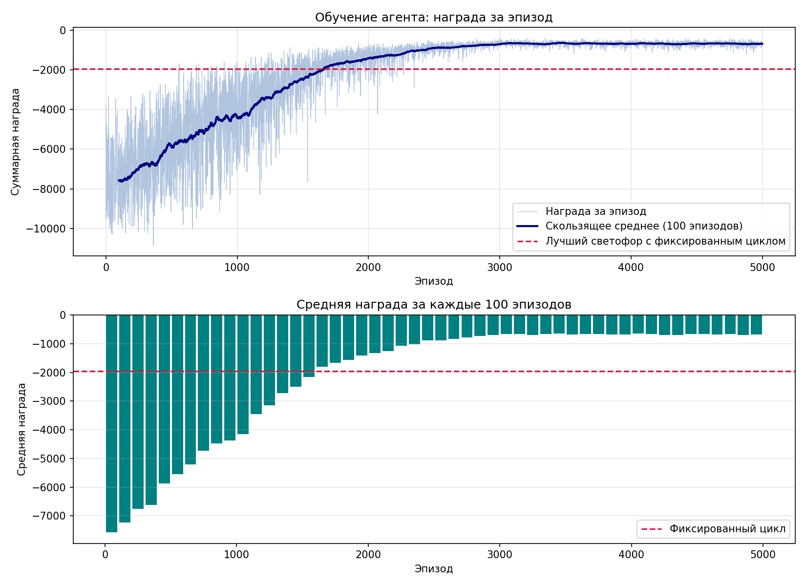
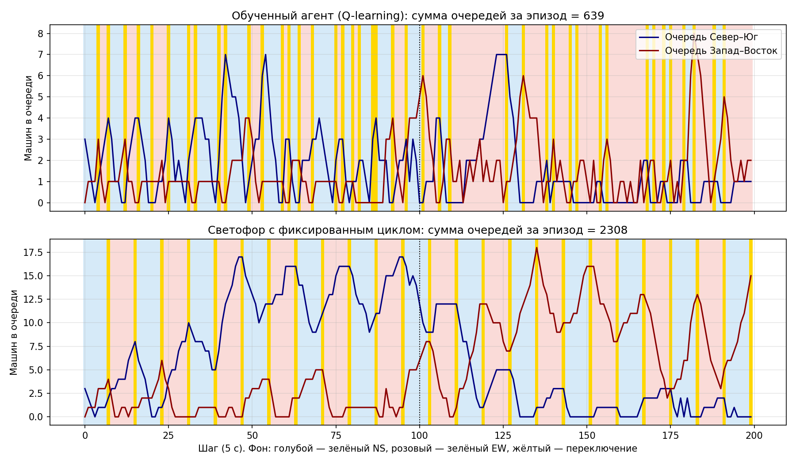
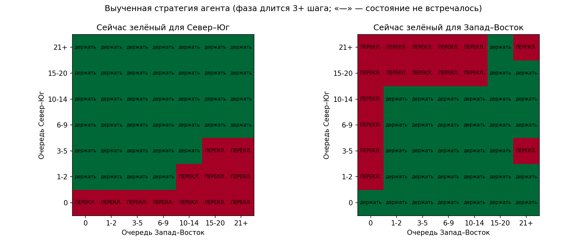
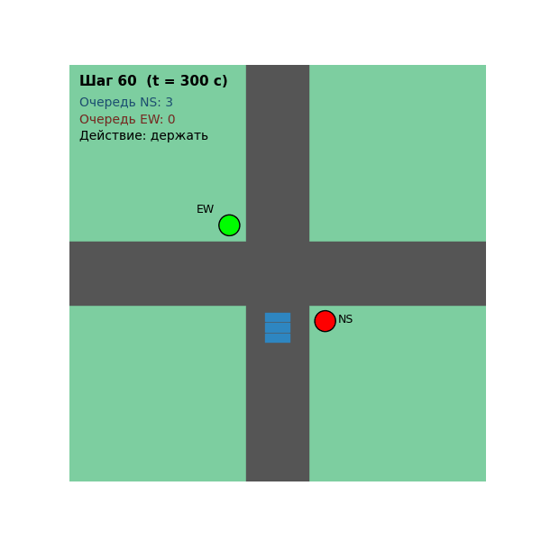

# Управление светофором на перекрёстке с помощью Q-обучения

Лабораторная работа «Изучение и применение алгоритмов обучения с подкреплением для решения прикладной задачи».

Агент на основе табличного Q-обучения (Q-learning) управляет светофором на перекрёстке двух дорог (Север–Юг и Запад–Восток). Каждые 5 секунд агент видит длины очередей и решает, оставить текущий сигнал или переключить его. Цель — минимизировать время ожидания машин.

Отчёт по работе: [docs/Отчёт_RL_светофор_Конышева.docx](docs/Отчёт_RL_светофор_Конышева.docx)

## Постановка задачи

- **Состояние:** длина очереди на каждом направлении (7 интервалов), текущая фаза светофора, время работы фазы (0, 1, 2, 3+ шагов). Всего 392 состояния.
- **Действия:** `0` — оставить фазу, `1` — переключить (на один шаг включается жёлтый, никто не проезжает).
- **Награда:** `r = −(q_NS + q_EW)` — минус число машин в очередях после шага.
- **Эпизод:** 200 шагов по 5 с (≈ 17 минут). В первой половине час пик на направлении Север–Юг, во второй — на Запад–Восток.
- **Гиперпараметры:** α = 0,1, γ = 0,95, ε линейно уменьшается с 1,0 до 0,02 за 3000 эпизодов, всего 5000 эпизодов.

## Запуск

```bash
pip install -r requirements.txt
python3 traffic_light_qlearning.py
```

Обучение занимает около минуты. Графики, анимация, Q-таблица и числовые итоги сохраняются в папку `results/`.

## Результаты

Сравнение на 100 тестовых эпизодах с одинаковым потоком машин:

| Стратегия | Средняя задержка на машину |
|---|---|
| Q-learning агент | 13,1 с |
| Лучший фиксированный цикл (зелёный 40 с) | 40,3 с |
| Случайное переключение | 157,4 с |

Агент сокращает время ожидания на 67,5 % по сравнению с лучшим светофором с фиксированным циклом.

### Кривая обучения



### Очереди в одном эпизоде: агент и фиксированный цикл



### Выученная стратегия



### Анимация работы агента


